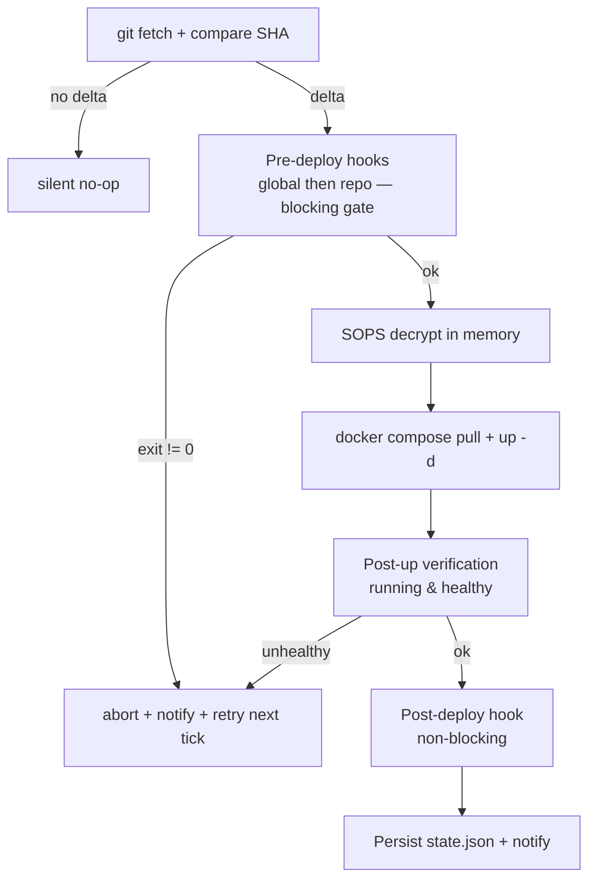

# The deploy pipeline

Every `poll_interval`, for each stack, plico runs the same sequence. If nothing
changed, it is a silent no-op.

## Step by step

1. **Detect a change.** `git fetch`, then compare the `origin/<ref>` SHA with
   the last deployed SHA (persisted in `state.json`). No delta → silent no-op.
   For [monorepos](monorepo.md), the diff is scoped to the stack's subdirectory.

2. **Pre-deploy hooks (blocking gate).** The operator's **global** hooks run
   first, then the **repo's** hooks. `exit != 0` aborts the deployment — no
   deploy, ever, except a deliberate `deploy-now --skip-pre --force`. This is
   the backup gate. Full model in [Layered hooks](hooks.md).

3. **Decrypt secrets in memory.** `sops exec-env secrets.enc.env -- docker
   compose … up -d`, or tmpfs mode on Linux. Cleartext never lands on disk under
   `base_dir`. See [Secrets](secrets.md).

4. **Pull and up.** `docker compose pull` (when `force_pull` is set), then
   `up -d`. A failed pull leaves the running stack untouched.

5. **Post-up verification.** Every service must be `running` and `healthy` (or
   have no healthcheck) within `verify_timeout`; an `unhealthy` service fails
   the run immediately.

6. **Post-deploy hook + persist.** An optional post-deploy hook (non-blocking),
   a notification, and the new SHA persisted to `state.json`.

## Concurrency

A run still **in flight** at the next tick is **skipped, never piled up**. Two
deployments of the same stack never overlap, and `max_concurrent_deploys`
bounds how many *different* stacks deploy at once.

## Failure handling

After a failed post-up verification, plico still records the new SHA, so a
broken revision is **not redeployed in a loop**. Recovery is deliberate: a
`git revert` in the stack repo, or `plico deploy-now --force`. This is the
manual-by-design [rollback model](../operations/upgrades.md#rollback).
